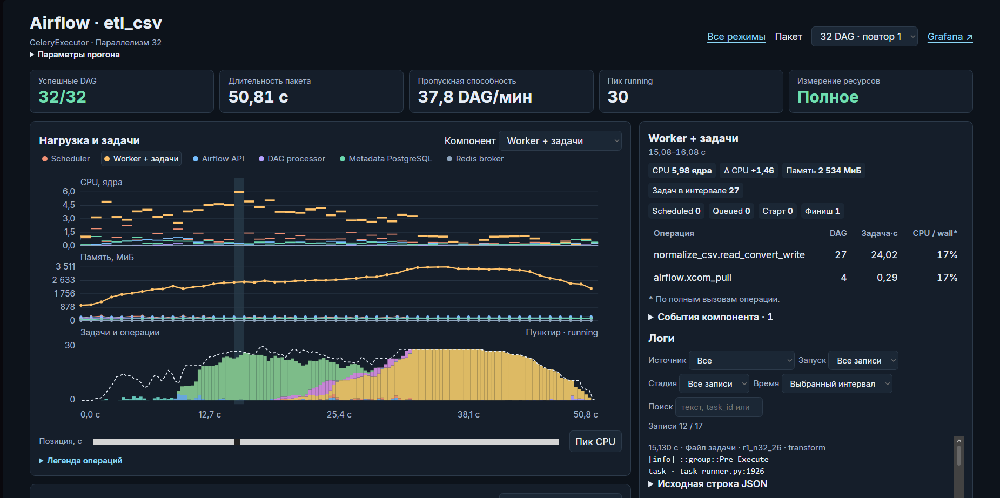

# Airflow Profiler

Нагрузочный стенд для Airflow 3.2.2 с CeleryExecutor. Измеряет CPU, память, ожидание запуска и накопление очереди. Операции задач и логи Airflow сопоставляются по времени.

## Запуск

Нужны Docker с Compose и Linux-контейнеры с cgroup v2. Проверено в Docker Desktop. Команды выполняются из корня репозитория.

```powershell
Copy-Item .env.example .env
docker compose up -d --build --wait
```

В Linux перед запуском:

```bash
cp .env.example .env
export BENCH_RUNNER_UID=$(id -u)
docker compose up -d --build --wait
```

**Все дашборды: http://localhost:18773.** Сервер отчётов запускается вместе со стендом. Отчёты появляются после выполнения тестов.

- Airflow: http://localhost:18080
- Grafana: http://localhost:13000/d/airflow-cgroups
- Prometheus: http://localhost:19090/targets

Это локальный тестовый стенд с упрощённой авторизацией. Порты опубликованы только на loopback. Старый стенд и отдельный Python-сервер отчётов должны быть остановлены перед запуском этой копии: номера портов совпадают. Данные хранятся в отдельных Docker-томах проекта `airflow-profiler`.



# Что показало профилирование Airflow

В серии из 32 запусков DAG лимит Airflow и число слотов Celery увеличивали с 16 до 32.

- **CPU-задачи: 51 → 83 с, на 62% дольше.** Дополнительные слоты не ускорили вычисления. Для этой нагрузки увеличение параллелизма оказалось невыгодным.
- **CSV → PostgreSQL: 122 → 245 с. API → PostgreSQL: 37 → 105 с.** Удвоение числа слотов увеличило время обработки в 2 и 2,9 раза соответственно. Для этих сценариев конфигурация с 16 слотами завершала пакет быстрее.
- **HTTP I/O: 14,6 → 11,2 с, на 24% быстрее. Витрина ClickHouse: 20,6 → 18,2 с, на 12% быстрее.** Для задач с ожиданием внешней работы дополнительные слоты дали выигрыш. Один лимит параллелизма для CPU и I/O здесь не подходит.
- **При четырёх слотах и входящей HTTP-нагрузке 120 DAG/мин завершалось 48 DAG/мин.** Накопился 41 незавершённый DAG, ожидание старта p95 достигло 43 с при цели 5 с. Все 96 запусков завершились успешно, но требование по времени запуска не выполнено. Значит, одного показателя успешности DAG недостаточно: нужны скорость обработки и ожидание старта.

## Первая проверка

```powershell
docker compose run --rm runner noop --series 8 --repeats 1
```

Откройте http://localhost:18773 и выберите «Профили шести нагрузок». Runner выводит также каталог конкретного отчёта в `results`.

## Нагрузки

| Режим | Работа | Параметры |
| --- | --- | --- |
| `noop` | Пустая задача: расходы запуска | — |
| `cpu` | SHA-256 | `--cpu-iterations` |
| `io_http` | Ожидание ответа и скачивание HTTP | `--delay`, `--io-bytes` |
| `etl_csv` | CSV → преобразование → PostgreSQL COPY | `--rows`, `--cols` |
| `api_ingest` | HTTP API → нормализация pandas → PostgreSQL COPY | `--pages`, `--page-rows`, `--delay` |
| `clickhouse_mart` | Построение и проверка витрины ClickHouse | `--days` |

Задержка задаётся в секундах, размер HTTP-ответа — в байтах. Для API задержка применяется к каждой странице. Число DAG в отчёте означает число запусков одного DAG. В DE-пайплайнах стадии связаны последовательно; разные запуски могут выполняться параллельно.

## Способы проверки

Запускайте эксперименты последовательно.

**Пакеты:** одновременный запуск заданного числа DAG. Перед измерениями выполняется один прогревочный запуск.

```powershell
docker compose run --rm runner etl_csv --series 8,16,32 --repeats 3 --rows 100000 --cols 12
```

**Постоянная нагрузка:** 12 запусков в минуту в течение двух минут.

```powershell
docker compose run --rm flow io_http --profile steady --rate 12 --stage-seconds 120 --delay 2.5
```

**Рост нагрузки:** по две минуты при 12, 60 и 120 запусках в минуту.

```powershell
docker compose run --rm flow io_http --profile steps --rates 12,60,120 --stage-seconds 120 --delay 2.5
```

**Пиковая нагрузка:** после двух минут обычной нагрузки добавляются 16 одновременных запусков, затем обычная нагрузка продолжается ещё две минуты.

```powershell
docker compose run --rm flow io_http --profile burst --rate 12 --burst-runs 16 --stage-seconds 120 --delay 2.5
```

`flow` создаёт запуски по времени, независимо от завершения предыдущих; отдельного прогрева нет. `--queue-limit 5` задаёт целевое ожидание старта задачи. `--max-pending 128` останавливает новые запуски при накоплении незавершённых DAG. `--drain-timeout 600` ограничивает ожидание оставшихся DAG после прекращения нагрузки.

## Лимиты

Измените `.env`:

```dotenv
BENCH_PARALLELISM=16
BENCH_WORKER_CONCURRENCY=8
```

Первое число — общий лимит выполняющихся задач Airflow, второе — слоты Celery worker. Это не количество ядер. Примените настройки и переподключите профайлер:

```powershell
docker compose up -d
docker compose up -d --no-deps --force-recreate process-profiler
docker compose up -d --wait
```

Для сравнения меняйте один параметр при одинаковой нагрузке.

## Отчёты

В нагрузочном отчёте проверяйте скорость поступления и завершения DAG, рост незавершённых запусков и ожидание старта p95. Все задачи могут завершиться успешно, но слишком поздно.

«Ресурсы и логи» открывает CPU и память компонентов, процессы worker и операции Python. Выберите компонент и время на графике, чтобы посмотреть события и логи этого интервала.

Измеряются scheduler, worker, API, DAG processor, metadata PostgreSQL и Redis. Worker включает процессы задач. PostgreSQL загрузки, HTTP-источник и ClickHouse работают отдельно.

HTML, JSON, логи и исходные снимки сохраняются в `results` и не попадают в Git.


## Остановка

```powershell
docker compose stop
```

Данные и отчёты сохраняются. `docker compose start` запускает остановленные контейнеры.
